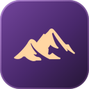

# Summit — The Nine Summits

Activity and progress tracker with a big bet on gamification.

This app goes a bit overboard with scope, but for good reason. The bet on gamification needs to demonstrate why users would be inclined to return and log their daily entries. This is done through a simple UI that rewards users weekly and at each summit, aiming for 3+ cycle retention through leveling, badges, and referral unlocks.

## Mechanic

The operation is designed to be as straightforward as possible. Five completed daily check-ins within seven days earn a stamp. Gather 4 stamps to level up.

Earned stamps carry over across missed weeks to avoid discouraging users. Losing three weeks of progress over a single missed week could hurt retention by discouraging users from starting a new month-long cycle.

Logging entries on all 7 days earns a weekly bonus that can be spent on a day pass or a 20% discount for one month. A pass covers one missed day toward the weekly goal.

Referrals unlock when you start **Denali**, the third climb and the demo’s proxy for the 3-cycle break-even point. Each successful referral earns 200 demo points (a lot), which can be spent on store rewards.

## Demo walkthrough

The demo starts on the final weekend of the Aconcagua climb. I've designed it to be completed in under 30 seconds, so don't be discouraged by the lengthy explanation above.

All you need to do is:

1. Complete the 3 entries for Saturday (notes are optional).
2. Tap the **Next** arrow beside **3/3** in the top-right corner of the Daily check-in card.
3. Add 3 entries for Sunday.
4. Claim Aconcagua’s crest to start Denali and unlock referrals.

If you want to mess around a bit longer, you can unlock referrals directly from the referrals page for a preview. Everything else is pretty much just for show.

## Run it

With Node 22, run this from the project folder.

```sh
npm install && npm run dev
```

Open `http://localhost:3000` on the computer. On an iPhone connected to the same Wi-Fi, open the **Network** URL printed in the terminal.

To serve a production build after installing dependencies, run `npm run build && npm start`.

## Data and tools

The app starts with bundled sample data and saves logs and progress in each browser. I kept the demo local and left out external REST APIs so it runs without an API key, account, or backend setup.

I used the supplied Next.js scaffold, Codex for implementation and testing, and ImageGen for the expedition artwork.
